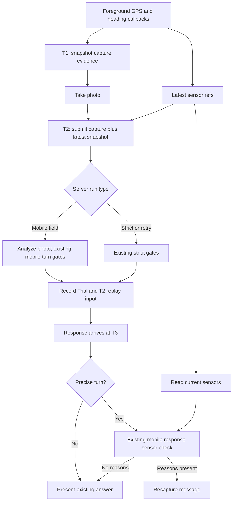
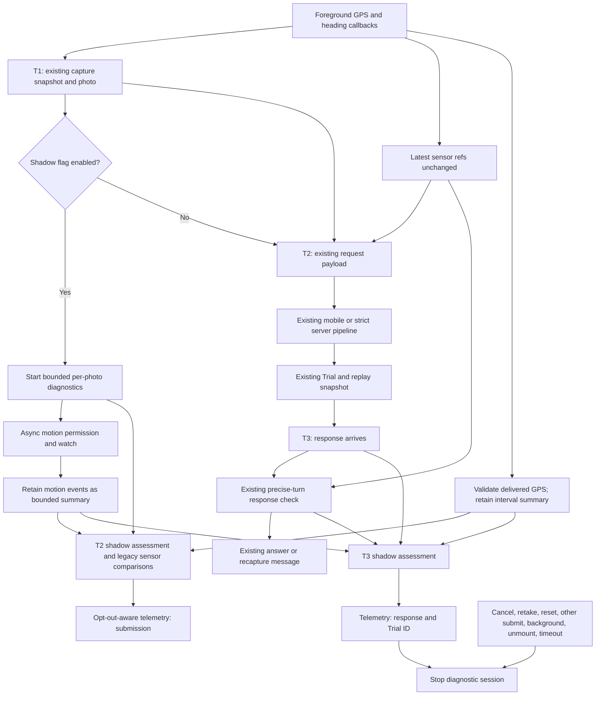

# Issue #70: GPS and motion movement assessment in shadow mode

> Historical v1 write-up. The November 14, 2026 revision adds raw speed history, bounded samples, coverage validation, and stricter treatment of missing evidence. See [the current v2 implementation and verification](issue-70-speed-history.md). Classification rules, examples, and test counts below describe the earlier implementation.

This change adds diagnostic evidence for Last Meters without changing navigation authorization. The existing strict and mobile Safety Gates remain responsible for every answer. The new classifier is `gps-motion-shadow-v1`, reports `mode: "shadow"`, and is disabled unless `EXPO_PUBLIC_LAST_METERS_MOVEMENT_SHADOW=true` is present when the app bundle is built.

No field validation has established that the new classifier can safely replace the existing movement gate. Stage B is not enabled. A `movement_not_detected` result does not authorize a precise turn, and `movement_uncertain` must never independently authorize one in a future integration.

## Investigation and root cause hypothesis

The reported symptom is plausible: two GPS positions can differ by more than five meters while a pedestrian remains stationary. The strict policy compares those positions directly. The mobile policy instead tolerates a displacement inside a heuristic scale derived from the two reported accuracy values. Neither comparison establishes whether the person actually moved. Real movement can also fit inside that scale, and endpoint comparisons alone miss walking away and returning.

These are limitations of the available evidence, not proof that a particular recorded Safety Gate was incorrect. A ground-truth observation of the pedestrian, matching timestamps, and the complete set of safety reasons are needed to label a field Trial. Existing logs contain the submitted sensor snapshot but do not contain the client's final sensor check after the response arrives.

The investigation also found that the location callback replaces the latest fix without checking ordering or duplicates; an old cached fix can remain the latest value until another callback arrives. Missing latest accuracy is replaced with capture accuracy in the existing request payload. Shadow assessment preserves the raw missing value instead of treating that fallback as a new measurement. None of these legacy behaviors is changed in Stage A.

## Capture-to-guidance lifecycle

| Moment | Existing evidence and evaluation | New diagnostic work |
| --- | --- | --- |
| T1, photo capture | `MainScreen.takePhoto` copies the current GPS object, heading, and their timestamps immediately before `takePictureAsync`. `photoCapturedAt` records invocation, not a hardware shutter timestamp. | Start a per-photo session without awaiting permission or native subscription startup. Copy raw capture GPS and assign `captureId`. |
| Between T1 and T2 | The existing foreground location watcher updates `locationRef`; it requests navigation accuracy, `distanceInterval: 0`, and `timeInterval: 1000`. These options do not certify an exact sampling cadence. | Observe delivered GPS fixes and motion events. Retain counts, maximum displacement, and evidence of an excursion rather than a coordinate/event history. |
| T2, submission | Send original capture coordinates and accuracy plus a snapshot of latest GPS/heading. Record the phone's `requestedAt`. The server stores this request in the existing replay input. | Evaluate quality and movement; record a `submission` telemetry event with strict/mobile counterfactual reasons and `requestId`. |
| Server processing | Mobile field policy analyzes the photo before turn checks and evaluates submitted sensor freshness at server receipt. Strict and replay policies retain their existing behavior. | No new server decision or replay input. |
| T3, response | Before speaking a precise turn, read current sensors again. Existing client reasons cause recapture. Withheld/descriptive answers bypass this turn-only check. | Record a `response` event with the new assessment, exact final client reasons, server reasons/warning, `preciseTurnCheckApplied`, and returned `testLogId`. End the session. |

Relevant existing implementation: `mobile/src/screens/MainScreen.tsx`, `mobile/src/utils/lastMetersSafety.ts`, `mobile/src/utils/mobileLastMetersGuidance.ts`, `mobile/server/utils/lastMetersGuidancePolicy.ts`, and `mobile/server/services/lastMetersService.ts`.

### Existing movement formulas and safety invariants

Let `d` be the Haversine displacement from capture to latest GPS, `ac` capture accuracy, and `al` latest accuracy, in meters.

- Strict: add `moved_since_capture` when current GPS is valid/fresh and `d > 5`.
- Mobile: obtain the complete strict reason list, then remove only `moved_since_capture` when `d <= max(5, hypot(ac, al))`. Legacy handling may substitute capture accuracy when latest accuracy is missing or invalid.
- GPS accuracy greater than 20 meters, negative/nonfinite accuracy, unavailable current coordinates, stale capture GPS, and other independent reasons retain their existing treatment. Exactly five meters is not `> 5`.
- Capture GPS must be within ten seconds of photo time. Existing photo/capture age limits are 60 seconds; current GPS/heading freshness is 15 seconds; the existing future-time tolerance is two seconds.
- Mobile server checks freeze both age references at request receipt. Client response checks freeze capture age at `requestedAt` while checking latest freshness at T3. Strict late checks can age capture evidence during processing while checking submitted current readings at receipt. These arguments are unchanged.
- Retries and pinned-panorama runs continue using the strict policy. No change is made to Issue #67 bearing uncertainty logic, orientation rebasing, confidence checks, destination verification, or the saved Trial/replay contract.

The two accuracy values are reported quality indicators. Their root-sum-square is neither a hard error bound nor a calibrated probability that movement occurred.

## GPS quality and deterministic classification

`gpsQuality.ts` validates each coordinate, positive finite accuracy, positive finite epoch timestamp, capture/photo proximity, measurement age, duplicate timestamps, reverse ordering, and future values. Zero accuracy is unsuitable for the new assessor even though the legacy gate permits it. A duplicate capture/latest timestamp is unusable even when both coordinates are identical; equal timestamps with different coordinates also report inconsistency.

For an ordered pair, the diagnostic adjusted speed is `max(0, d - hypot(ac, al)) / elapsedSeconds`. A value above 8 m/s marks an implausible jump. This is an initial pedestrian-oriented diagnostic threshold, not a measured walking speed, a calibrated physical limit, or an instruction to discard a real movement event. The interval collector also checks successive segments so an abrupt out-and-back jump is not made credible merely by a long capture-to-response interval. Small displacements are retained.

Duplicate/future/accuracy/speed checks follow the kinds of validation used by established tracking systems; no vehicle defaults or distance-based suppression were copied. See the primary [Traccar filter configuration reference](https://www.traccar.org/configuration-file).

`movementAssessment.ts` applies the following ordered rules:

1. Missing, stale, invalid, poorly accurate, duplicate, or inconsistent endpoint evidence produces `movement_uncertain`, with the original GPS issues.
2. Simultaneous moving and stationary activity flags produce `movement_uncertain`. Stationary-only evidence conflicting with a GPS excursion also produces uncertainty; stationary activity never cancels displacement evidence.
3. Usable GPS displacement above `max(5, hypot(ac, al))`, or a previously retained usable excursion above that reference, produces `movement_detected` unless the preceding conflict rule applies.
4. Post-capture iOS activity evidence with medium/high confidence can corroborate a displacement of at least five meters inside the GPS noise reference. The summary stores post-capture confidence separately; high-confidence activity that began before capture cannot lend confidence to a later low-confidence event. Activity alone never proves a distance traveled.
5. Moving activity with unresolved/small displacement, or displacement over five meters still inside the noise reference, produces `movement_uncertain`.
6. For remaining small-displacement cases, invalid/out-of-order interval evidence, interrupted motion collection, or rejected motion events produce uncertainty.
7. Otherwise, fresh GPS consistent with the capture neighborhood produces `movement_not_detected`. Rationale distinguishes observed stationary activity from the absence of independent stationary evidence.

The summary retains an excursion even if the latest fix returns near the capture position, and retains walking/running after a later stationary event. Available evidence can therefore differ from the final activity label or final displacement. The assessor returns displacement, accuracy, timestamps, GPS quality, motion summary, interval summary, and rationale; it has no API that authorizes guidance.

### Illustrative results

These are deterministic hypothetical inputs, not measured field results. Both endpoints are valid, fresh, distinct in time, and pass jump validation; there are no additional interval faults. Accuracy is identical at both endpoints. “Strict/mobile” below concerns only their movement reason, not the complete navigation result.

| Ground truth supplied by tester | Measured GPS displacement | Accuracy each | Motion evidence | Strict moved | Mobile moved | Shadow result |
| --- | ---: | ---: | --- | --- | --- | --- |
| Stationary | 2 m | 3 m | Stationary | No | No | `movement_not_detected` |
| Stationary | 8 m | 3 m | Stationary | Yes | Yes | `movement_uncertain`: GPS/activity conflict |
| Stationary | 8 m | 14 m | Stationary | Yes | No | `movement_uncertain`: displacement overlaps GPS noise |
| Stationary | 15 m | 14 m | Stationary | Yes | No | `movement_uncertain`: displacement overlaps GPS noise |
| Stationary | 15 m | 3 m | Stationary | Yes | Yes | `movement_uncertain`: GPS/activity conflict |
| Walked 5 m | Exactly 5 m | 3 m | Medium/high post-capture iOS walking | No | No | `movement_detected`: corroborated displacement |
| Walked 10 m, then stopped | 10 m | 3 m | Walking retained, then stationary | Yes | Yes | `movement_detected` |
| Walked 10 m | 10 m | 14 m | Medium/high post-capture iOS walking | Yes | No | `movement_detected`: corroborated displacement |
| Walked 10 m | 10 m | 14 m | Android walking, onset unknown | Yes | No | `movement_uncertain` |
| Walked 20 m | 20 m | 3 m | Walking | Yes | Yes | `movement_detected` |
| Walked several meters | 2 m | 3 m | Walking | No | No | `movement_uncertain`: activity without resolved displacement |
| Walked away and returned | 2 m final, usable 10 m excursion | 3 m | Walking retained | No at endpoint | No at endpoint | `movement_detected`: retained excursion |
| Unknown | Any | Missing/invalid or over 20 m | Any | Depends on existing gate | Depends on existing gate | `movement_uncertain`: GPS quality |

A denied motion permission never becomes a stationary event. An unavailable/unsupported sensor does not prove immobility; a usable small GPS displacement can still be described as no movement detected, with no independent stationary evidence. This diagnostic label has no effect on the existing Safety Gate.

## Expo API and native requirements

The initial investigation used the then-local `expo` 57.0.26 and `expo-location` 57.0.20. After the requested GitHub update on November 12, 2026, the working branch includes upstream main `95f613baddf59da8ca4a52f7d14b44372818af21`. The upstream lockfile initially installed `expo` 58.0.23 and `expo-location` 58.0.20. For the requested Expo Go tunnel session, `expo install --fix` aligned the SDK 58 patches to **Expo 58.0.25** and **expo-location 58.0.22**; `expo install --check` now reports dependencies are up to date. The installed JavaScript/types, config plugin, and iOS/Android timestamp behavior were rechecked on SDK 58; this shadow implementation remains compatible. No third-party tracking framework was added.

The installed package exports `requestMotionActivityPermissionsAsync()` and `watchMotionActivityAsync(callback, errorHandler?)`, the latter resolving to a removable subscription. Events contain an `activities` map for automotive, cycling, running, walking, stationary, and unknown, with `detected` and confidence values 0/1/2. These APIs support iOS and Android. The public [Expo SDK 58 Location reference](https://docs.expo.dev/versions/v58.0.0/sdk/location/) documents the permission/watch APIs and foreground support; installed native source determines the timestamp details below.

- iOS uses `CMMotionActivity.startDate`, which can precede capture or subscription. An old initial activity is retained as context, not counted as a newly observed post-capture transition. Detected activities share the native event's confidence.
- Android's installed Expo wrapper stamps activity with `System.currentTimeMillis()` on delivery. It does not expose the activity onset timestamp. Consequently, Android activity alone cannot satisfy the post-capture-onset corroboration rule. Native confidence is mapped into Expo's 0/1/2 levels; these are not pedestrian displacement probabilities.
- Permission/native setup is asynchronous and events can arrive late. There is no guaranteed detection latency, continuous coverage, or promise that a brief walk will be reported before T3. `incompleteCoverage` remains true, including when some stationary events were observed.
- Web is unsupported for these motion APIs. Permission denial, unavailable hardware, old native binaries, and native errors remain explicit availability states.

The installed plugin supports `motionUsagePermission` for iOS `NSMotionUsageDescription`, and `isAndroidMotionActivityEnabled: true` for Android activity-recognition declarations. Android 10+ additionally needs the runtime permission. The app configuration adds those supported fields; it does not enable background motion tracking. Config-plugin changes require a newly built native binary, not only a JavaScript update, as described by [Expo's app-configuration documentation](https://docs.expo.dev/versions/v58.0.0/sdk/location/#configuration-in-app-config). Verify the generated Info.plist/manifest and real permission flow on physical devices before field collection.

Native source locations checked under `mobile/node_modules/expo-location`: `src/Location.ts`, `src/Location.types.ts`, `plugin/src/withLocation.ts`, `ios/LocationModule.swift`, and `android/src/main/java/expo/modules/location/LocationModule.kt`. Public latest-version documentation must not substitute for checking the deployed native package.

## Session limits, privacy, and diagnostics

Only the explicit shadow flag starts motion collection. The session begins at photo capture, makes no blocking wait before photography, and is bounded to 90 seconds. Completion, cancellation, failed capture, retake/new photo, another Question submission, reset, background/inactive, and unmount stop the relevant session. A late permission result cannot start a stopped watch; a subscription resolving after stop is removed. Late callbacks are ignored. Native errors are not automatically retried.

An iOS system permission dialog can make the app inactive and stop that initial session. Complete the permission flow and take another photo for a normal field interval; retain the interrupted first attempt when evaluating permission/startup behavior. T3 diagnostics are captured before normal session teardown, so a completed response need not have a `motionStopReason` yet. Cancelled or failed requests can have a submission event without a response event.

The existing telemetry event is `last_meters_movement_shadow`, with phases `submission` and `response`. Development collection additionally requires `EXPO_PUBLIC_TELEMETRY=1`; production telemetry retains its existing enablement and analytics opt-out. Telemetry is queued and best effort, so absent events must not be interpreted as no movement.

For an opted-in local field-testing session, start Metro from `mobile` with these non-secret environment flags, then reload the app. Use a compatible rebuilt native binary for the motion-permission configuration; this command alone does not rebuild it:

```powershell
$env:EXPO_PUBLIC_LAST_METERS_MOVEMENT_SHADOW = "true"
$env:EXPO_PUBLIC_TELEMETRY = "1"
npm start
```

To disable the experiment, remove or set the first flag to `false`, restart Metro, and reload. GPS interval diagnostics continue when motion permission or native motion setup fails; they still stop on the photo-session lifecycle and at the 90-second bound. The real GPS watcher and navigation behavior are unchanged.

The diagnostic allowlist includes timestamps, accuracies, displacement/noise reference, quality issues, bounded counts/maxima, motion availability and coverage, classifier/rationale, strict/mobile counterfactual reason lists, and the actual response-check reasons. It excludes raw coordinates, location/activity histories, photos, destination text, and free-form user input. Strings are capped at 500 characters; nonfinite numbers are omitted.

`captureId` identifies one photo session, `requestId` identifies one submission, and T3's `testLogId` links to the server Trial. These allow a protected telemetry export to be joined with the existing Trial and independently recorded test ground truth. Submission telemetry cannot contain a server-generated Trial ID that does not exist yet. `strictReasons`/`mobileReasons` are sensor-policy comparisons at the diagnostic snapshot's time references; they are not complete replays of server policy or proof that either full pipeline would authorize a turn. Use `serverReasons`, `finalClientReasons`, and `preciseTurnCheckApplied` for the actual path.

There are no database migrations, request fields, replay-schema changes, new endpoints, or changes to stored Last Meters names. Existing analytics consent and protected telemetry export remain in use. Server Trials continue storing T2 evidence only; T3 diagnostics are separate telemetry records rather than edits to the recorded Trial.

## Before and after

Before:



After Stage A:



There is intentionally no arrow from either shadow assessment to the authorization/presentation decision.

## Files and verification

| File | Purpose |
| --- | --- |
| `mobile/src/utils/gpsQuality.ts` | Pure GPS measurement quality assessment |
| `mobile/src/utils/motionActivityInterval.ts` | Bounded motion evidence collection and cleanup |
| `mobile/src/utils/movementAssessment.ts` | Deterministic three-state shadow classifier |
| `mobile/src/utils/lastMetersMovementShadow.ts` | Per-photo interval, legacy comparison, safe telemetry projection |
| `mobile/src/screens/MainScreen.tsx` | T1/T2/T3 integration and lifecycle cleanup |
| `mobile/src/api/telemetry.ts` | Constant for `last_meters_movement_shadow` |
| `mobile/app.json` | Supported native motion-permission configuration |
| `mobile/src/test/gpsQuality.test.ts` | GPS validation fixtures |
| `mobile/src/test/motionActivityInterval.test.ts` | Motion timing, availability, confidence, and cleanup fixtures |
| `mobile/src/test/movementAssessment.test.ts` | Classifier scenarios and legacy safety invariants |
| `mobile/src/test/lastMetersMovementShadow.test.ts` | Interval history, phase comparison, and privacy projection tests |
| `mobile/src/test/lastMetersVoicePlayback.test.ts` | Regression coverage for final response presentation |
| `mobile/src/test/runAll.test.ts` | Register the added suites |
| `docs/issue-70-movement-shadow.md` | Engineering handoff and field acceptance plan |

The existing strict/mobile/replay implementation remains unchanged. Relevant playback/navigation regression tests retain their authorization expectations.

Verification completed on November 12, 2026. Before the upstream update, the baseline passed 530 tests and the Issue #70 implementation passed 617, including 87 added cases. After syncing upstream main and installing SDK 58, full QA passed **614 tests**; the upstream dashboard retirement changed the suite contents. All 87 Issue #70 additions remain registered and pass. Native and backend TypeScript checks also pass with the upstream TypeScript 6.0.3 configuration. All checks ran locally with mocked external providers; no paid Maps or OpenAI request was made.

| Check | Result |
| --- | --- |
| Targeted GPS, motion, classifier, and shadow tests | 78 passed: GPS 17, motion 15, classifier 31, shadow session 15 |
| Real response/capture-handler playback suite | 22 passed, including 9 new shadow/capture lifecycle cases |
| Existing strict/mobile/replay/navigation regressions | Passed in the full suite; existing server snapshots unchanged |
| `cd mobile; npm run qa` | Passed on SDK 58: native TypeScript check and 614/614 tests, 0 failed/skipped |
| `cd mobile; npm run typecheck:server` | Passed |
| `git diff --check` | Passed |
| Physical iOS/Android permission and event-timing validation | Not performed; required before field collection |
| Ground-truth field comparison | Not performed; Stage B remains disabled |

Tests use deterministic sensor fixtures and mocked adapters/providers. Required coverage includes stationary drift at 2/8/15 m, actual 5/10/20 m spans, good/poor/invalid accuracy, stale/cached/duplicate/out-of-order/future timestamps, jumps, walking then stationary, walking with small GPS displacement, denied/unavailable motion, conflicting evidence, movement during server processing, simultaneous independent Safety Gate reasons, and cleanup races. Automated verification must not call paid Google Maps or OpenAI APIs.

## Field study and acceptance criteria before Stage B

1. Build the intended native binaries and record app version, classifier version, OS/device model, native permission state, and both flags. Verify opt-out, unavailable-native, no-event, and delayed-permission cases first. Confirm that disabled shadow collection makes no motion API calls and enabled collection never changes the submitted request, existing Safety Gate reason arrays, or spoken authorization outcome.
2. Use independently marked 0/5/10/20-meter positions and an observer's timestamped record. Label real movement separately from measured GPS displacement. Include walking then stopping, out-and-back movement, motion during server processing, body/phone rotation, and a stationary phone with GPS drift. Use open-sky and obstructed urban settings on at least three physical device models per supported OS. Do not derive ground truth from this classifier or a phone's GPS trace.
3. Collect at least 300 movement intervals and 150 stationary intervals per OS across the tested devices/settings, including at least 50 movement-during-processing and 50 out-and-back intervals per OS. Keep missing permission, unavailable sensors, startup gaps, interrupted sessions, and dropped telemetry as reported strata rather than removing them from the denominator. Expand the study when subgroup coverage is insufficient.
4. Join T2/T3 by `captureId` and `requestId`, then join T3 to the Trial by `testLogId`. Record real movement onset/end and distance in the observer sheet with those identifiers. Report capture-to-native-ready time, event delivery lag, T2/T3 event pairing, full safety reasons, classification confusion matrices, and uncertainty rates by platform, device, accuracy band, and scenario.
5. Require 100% preservation of legacy authorization outcomes and independent safety reasons in deterministic regression fixtures with shadow on/off. Require no active subscription or new accepted callback after stop in lifecycle tests, and collection bounded to the configured timeout. Require zero raw coordinates or histories in exported shadow payloads. For opted-in completed test requests with connectivity, target at least 95% matched T2/T3 diagnostic pairs; investigate every missing or mismatched pair.
6. Before proposing active integration, require zero observed `movement_not_detected` results among significant post-capture movement intervals in the held-out validation cohort. Report exact binomial confidence intervals: zero misses among 300 independent movement intervals gives an approximately 1% one-sided 95% upper bound, not proof of zero risk. Correlated repetitions and device strata reduce the strength of that inference; increase sampling as needed. Report `movement_detected` and `movement_uncertain` separately rather than treating uncertainty as a successful detection.
7. Pre-register the proposed Stage B decision policy and evaluate it offline on held-out data. Require no newly authorized precise turn when significant movement occurred, and no authorization based only on uncertainty, denied permission, or stationary activity. As an initial benefit target, require at least a 25% relative reduction in ground-truth-stationary movement-related recaptures versus the existing policy in the target deployment cohort, with confidence intervals and all independent reasons still applied. If that benefit is absent, retain shadow mode; a smaller count of movement labels alone is insufficient.
8. Stage B requires an explicit reviewed integration, independently established re-localization or recapture behavior for detected movement, a conservative policy for uncertain evidence, platform-specific validation, and a rollback switch. A passing unit suite or the passage of time does not enable it automatically.

Remaining limitations include uncalibrated GPS accuracy, correlated multipath drift, uncertain capture timing, missed movements between GPS fixes, delayed/probabilistic activity events, incomplete startup coverage, Android onset ambiguity, and best-effort telemetry. This implementation makes those limitations observable while keeping the current navigation behavior intact.
