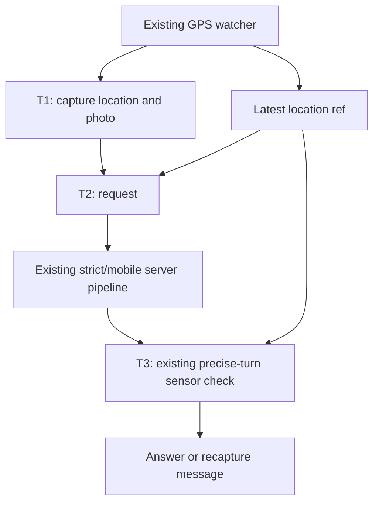
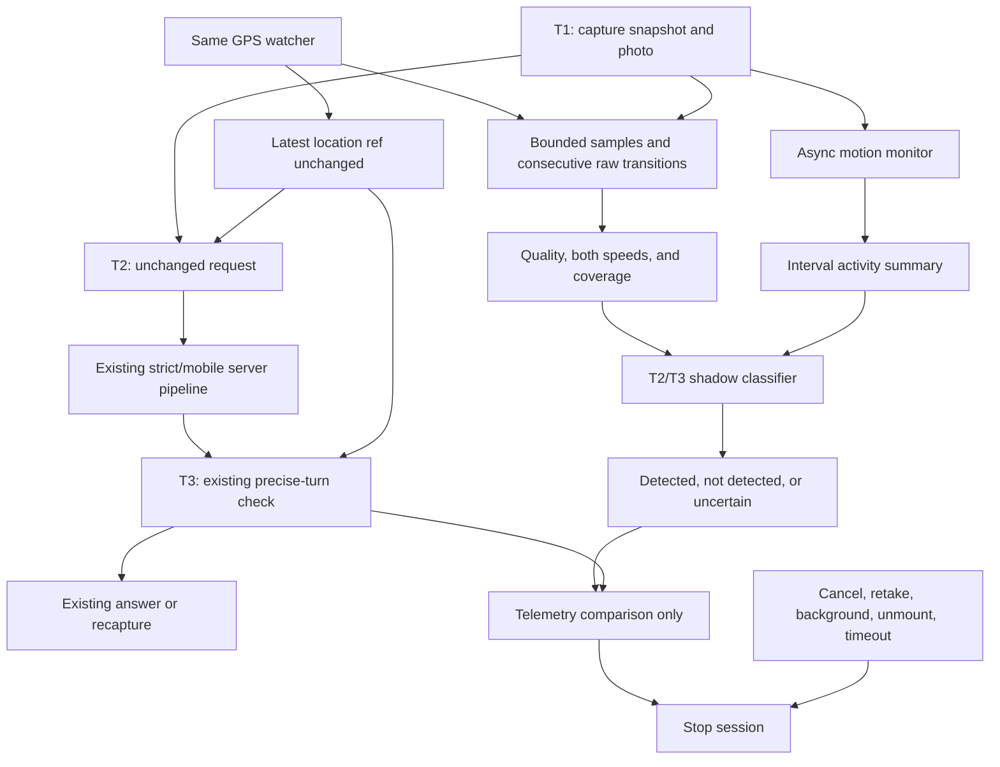

# Issue #70 — GPS quality, speed history, and motion diagnostics

Version: `gps-speed-motion-shadow-v2`. **Stage A / shadow mode only.**

The assessor does not authorize guidance, remove Safety Gate reasons, change Issue #67 bearing logic, or modify destination/panorama matching. It runs only when `EXPO_PUBLIC_LAST_METERS_MOVEMENT_SHADOW=true`. This iteration does not push, merge, deploy, or close Issue #70.

## Root cause hypothesis and previous behavior

GPS endpoints can differ because of physical movement, measurement noise, or both. Reported accuracy cannot reliably separate those causes, and an endpoint check misses walking away and returning. This is a plausible false-positive mechanism, not proof that historical Issue #70 Trials were incorrectly blocked. Ground truth, timing, displacement, and every co-occurring safety reason need review.

| Policy | Movement check | Status |
| --- | --- | --- |
| Strict | Add `moved_since_capture` when fresh valid endpoint displacement exceeds 5 m. | Unchanged. |
| Mobile | Remove only that movement reason when displacement is within `max(5, hypot(captureAccuracy, latestAccuracy))`. Legacy missing-accuracy fallback remains. | Unchanged. |
| New diagnostic | Validated GPS history, consecutive speed, reported speed, coverage, and motion evidence. | Telemetry only. |

The unmerged PR #65 sum-of-accuracies threshold was not copied. No Kalman filter, extra GPS subscription, or tracking dependency was introduced. The accuracy scale is a heuristic, not a hard error bound or calibrated movement probability.

The earlier shadow version retained endpoint quality and excursion counts but omitted device speed and raw consecutive distance/time speed. Some quiet cases with missing motion evidence could return no movement detected. This revision adds the missing evidence and makes insufficient quiet cases uncertain.

## Capture-to-guidance sampling

At T1, `takePhoto` snapshots the current GPS/compass immediately before `takePictureAsync`; its timestamp is camera-call invocation, not hardware shutter time. That immutable location object becomes the photo's reference.

The existing foreground `watchPositionAsync` requests navigation accuracy, `distanceInterval: 0`, and `timeInterval: 1000`. Actual platform scheduling is measured, never assumed. Its callback continues replacing the production `locationRef` without filtering; the same callback also feeds the separate diagnostic collector. The screen effect owns and removes that subscription. Late permission/subscription results after unmount are now guarded, and active-session native GPS failures are recorded.

T2 sends the original request payload. The server's mobile/strict policies and replay input are unchanged. The phone records a submission diagnostic snapshot. While the server processes the image, the phone continues foreground sampling. At T3, the existing precise-turn response sensor check still decides whether to present guidance or the recapture message. A second diagnostic snapshot records the actual final reasons and returned `testLogId`, then collection stops.

### Bounded local history

`GpsSample` stores measurement timestamp, latitude, longitude, nullable accuracy, and nullable device-reported speed. Each received entry also retains receipt time, the raw consecutive-pair calculation, acceptance, and quality reasons.

Default retention is 96 local records: the capture fix plus 95 recent callback entries. Lifetime counts, speed summaries, quality reasons, and maximum excursion survive buffer eviction. Invalid points do not replace the last accepted baseline. Raw transitions around a rejected point remain visible, and later good readings can recover against the last accepted fix.

Sessions stop at 90 seconds, completion, cancellation, retake, capture failure, reset, background/inactive, unmount, video capture, or a Question submission. Late native callbacks are ignored or removed. A new photo owns a new history; a cancelled old request cannot stop the new one.

A repeated request using the same old photo sees a closed, frozen history. It does not restart collection and pretend that earlier coverage was continuous. A new latest fix absent from that accepted history produces uncertainty; recapture creates a fresh session. Earlier movement evidence remains relevant to the old photo.

## Apparent GPS speed versus reported speed

```text
apparentSpeedMps = Haversine distance between consecutive fixes / actual elapsed seconds
reportedSpeedMps = location.coords.speed, when finite and nonnegative
```

For a 10 m coordinate change over 5 s, apparent speed is 2 m/s regardless of whether the device reports 0.4 m/s. Both values are retained. Missing speed is null, never zero. Reported speed can itself be GPS-derived and is not assumed independent ground truth.

`calculateGpsSpeed` is pure. Invalid coordinates/timestamps, absent predecessors, and nonpositive elapsed time cannot fabricate a stationary reading. Negative/nonfinite reported speed has an explicit invalid reason. `assessGpsTransition` adds quality checks while leaving movement classification separate.

The earlier endpoint helper's `adjustedSpeedMps` remains a labeled diagnostic; it subtracts an accuracy heuristic and is not the raw apparent speed. New consecutive-pair filtering uses actual distance/time.

## Traccar-inspired quality checks

The primary reference is [Traccar FilterHandler.java](https://github.com/traccar/traccar/blob/master/src/main/java/org/traccar/handler/FilterHandler.java). Its independent validity, accuracy, timestamp, duplicate, and distance/time speed checks informed the design. Vehicle thresholds, zero-coordinate rejection, static-speed removal, and minimum-distance dropping were not copied.

| Check | Treatment |
| --- | --- |
| Coordinates | Reject nonfinite/out-of-range values. Geographic zero coordinates remain valid. |
| Accuracy | Mark missing, nonpositive, nonfinite, or poor values; never interpret accuracy as a guaranteed error radius. |
| Time | Check freshness, capture/photo consistency, future values, duplicate/inconsistent timestamps, and ordering. |
| Speed | Retain and reject implausible consecutive jumps. Rejection never proves stationarity. |
| Small changes | Retain them and report compatibility with the accuracy scale; do not automatically label them GPS drift. |
| Provider errors | Record unavailability even if the last location is recent; prevent a quiet adequate-coverage claim. |

All experimental references are centralized in `movementDiagnosticsConfig.ts`: accuracy 20 m; latest/capture age 15/60 s; capture/photo tolerance 10 s; future tolerance 2 s; maximum apparent speed 8 m/s; moving-speed reference 0.3 m/s; speed disagreement 1 m/s; significant displacement reference 5 m; maximum measurement gap 5 s; minimum quiet evidence 4 accepted samples, 3 s, and 80% measured coverage; 96 retained records and 90 s duration. These values are tunable initial diagnostic parameters, not scientifically validated decision boundaries.

Coverage uses actual accepted measurement timestamps, including startup/internal/tail gaps. Long missing spans do not count as covered time. Callback delivery gaps and sample age at delivery are separately logged. A closed or timed-out session cannot claim adequate current coverage. Slow movement is not discarded solely because speed is below 0.3 m/s.

## Expo Motion Activity

Installed versions verified: Expo 58.0.25 and expo-location 58.0.22. The installed JS/types, config plugin, iOS, and Android source were checked against the [SDK 58 Location reference](https://docs.expo.dev/versions/v58.0.0/sdk/location/#locationwatchmotionactivityasynccallback-errorhandler).

- `requestMotionActivityPermissionsAsync` and `watchMotionActivityAsync` exist; the latter returns a removable subscription. Events contain an activities map with detected flags and confidence 0/1/2.
- Keep walking/running, stationary, unknown, and simultaneous conflicting flags across the interval. Walking followed by stopping retains both observations.
- iOS uses `CMMotionActivity.startDate`; initial states can predate T1. Only sufficiently confident iOS moving events at/after T1 satisfy onset corroboration.
- The installed Android wrapper timestamps delivery, not activity onset. Android delivery alone cannot satisfy that onset rule.
- Missing permission, startup failure, no events, and unsupported hardware/platform remain explicit; no stationary event is fabricated. GPS diagnostics continue if only motion monitoring fails.
- Startup delay, event delivery gaps, observed event span, and silence duration are reported. Native callbacks are state changes, not a periodic heartbeat; silence is not automatically a lost event. `incompleteCoverage` remains true.

The supported `motionUsagePermission` and `isAndroidMotionActivityEnabled` plugin options are already configured. Permission changes require a compatible native binary. JS API availability does not prove that an arbitrary Expo Go installation has the needed native capability. Physical iOS/Android permission and event timing remain unverified. An initial iOS permission dialog can trigger inactive and stop that capture: grant permission, then recapture.

The installed Expo watch wrapper registers callbacks before awaiting native startup. If that promise rejects without returning a subscription, the app cannot obtain a removal handle for those internal callbacks; the monitor stops accepting events and does not retry within that session. Validate native failure behavior on the deployed binary; this change does not modify vendor code.

## Ordered classifier

The pure `assessMovement` result includes state, nullable displacement, sample count, GPS quality issues, reasons, endpoint quality, both speed summaries, history/coverage, and motion evidence.

1. Unusable endpoints, missing history, or a latest fix absent from accepted history yield `movement_uncertain`.
2. Conflicting activity flags, disagreeing valid speed sources, or stationary-only activity conflicting with substantial GPS displacement/reported motion yield uncertainty.
3. An accepted significant GPS excursion with usable transition evidence yields `movement_detected`; earlier excursions survive a near-capture final position. This does not infer walking from high speed alone.
4. At least 5 m displacement may be corroborated by sufficiently confident post-T1 iOS activity or multiple valid reported moving-speed samples. These remain uncalibrated evidence.
5. Unresolved activity/speed or displacement overlapping reported uncertainty yields `movement_uncertain`.
6. Quiet endpoints with inadequate GPS coverage, rejected or missing speed readings, interrupted monitoring, unavailable motion, or no useful motion events remain uncertain.
7. Only remaining adequately covered, jointly quiet GPS/speed evidence corroborated by stationary activity yields `movement_not_detected`. A single stationary event alone is insufficient. This is not proof that no physical movement occurred between observations.

| Independently assigned simulated ground truth | Observations | Diagnostic outcome |
| --- | --- | --- |
| Stationary | 2 m drift over covered 20 s, good accuracy, reported speed 0, stationary activity | No significant movement detected. |
| Stationary | 8 m drift inside reported uncertainty, device speed 0 | Uncertain. |
| Stationary | Building-scale drift with 60 m reported accuracy | Uncertain: poor quality. |
| Slow walking | 6 m over 30 s at about 0.2 m/s, usable fixes and walking evidence | Movement evidence retained despite low speed. |
| Walking then stopping | Usable 10 m excursion; walking then stationary | Movement detected. |
| Walking away/returning | Usable excursion, near-zero final displacement | Earlier movement retained. |
| Stationary | 100 m jump in 1 s, device speed 0 | Jump rejected; uncertain, not inferred stationary. |
| Unknown | Apparent speed 2.5 m/s, reported speed 0 | Uncertain: conflicting speed sources. |
| Stationary | Quiet endpoints with no motion events/permission | Uncertain. |

Ground truth labels are assigned independently of GPS displacement. Mocked examples verify behavior, not field accuracy.

## Telemetry, privacy, and old Trials

The existing opt-out-aware event remains `last_meters_movement_shadow`, with submission/response phases. Development logging also needs `EXPO_PUBLIC_TELEMETRY=1`. Queued telemetry is best effort: cancelled requests may have only T2, and missing events are not evidence of immobility.

Diagnostics include timestamps, accuracy, displacement, sample/rejection counts, measurement and delivery coverage, both speed summaries, maximum observed apparent speed including rejected jumps, motion availability/coverage, legacy reasons, and actual final reasons. `strictComparison` and `mobileComparison` are agree/disagree/inconclusive; uncertainty is inconclusive rather than a false no-movement vote.

`captureId`, `requestId`, and returned `testLogId` join per-photo/request telemetry with the saved Trial. Comparisons concern the movement reason, not a complete counterfactual server authorization.

Only allowlisted scalar values are uploaded: no coordinates, raw sample/pair arrays, photos, event histories, or destination text. Standard quality-category counts are selected explicitly, nonfinite numbers omitted, and strings bounded. Local history is not serialized.

No database/replay schema, stored timing keys, endpoint, or collection changes. Legacy Trial adapters and strict/mobile/replay regressions remain covered. Rows lacking speed diagnostics do not require migration.

## Before and after

Before:



After Stage A:



There is no arrow from the new classifier to guidance authorization.

## Files and verification

New: `mobile/src/utils/movementDiagnosticsConfig.ts`, `mobile/src/utils/gpsSampleHistory.ts`, `mobile/src/test/gpsSampleHistory.test.ts`, and this document.

Updated: `gpsQuality.ts`, `movementAssessment.ts`, `lastMetersMovementShadow.ts`, `motionActivityInterval.ts`, `MainScreen.tsx`; the corresponding movement/shadow/motion/actual-handler tests and `runAll.test.ts`; the v1 write-up now links here. Earlier staged SDK/native-permission/telemetry work is preserved and the user's Git index remains unchanged.

Verification completed November 14, 2026. The preceding implementation had 614 passing tests. This revision adds 54 cases; final full QA passes 668 tests. No paid Maps/OpenAI API or physical motion device is used in automated verification.

| Check | Final result |
| --- | --- |
| Focused GPS/speed/history/motion/response suites | 154 passed, 0 failed/skipped |
| `npm run qa` | Passed: native TypeScript check and 668/668 tests, 0 failed/skipped |
| `npm run typecheck:server` | Passed |
| `git diff --check` | Passed |
| Request/response gate AST comparison | Request payload/call and final production gate call identical to the pre-revision source; one GPS watcher |
| Git staging preservation | All 529 pre-existing index entries unchanged |
| Legacy strict/mobile/replay/Trial regressions | Included in full QA |
| Physical iOS/Android validation | Not performed |
| Field accuracy validation | Not performed; Stage B disabled |

One intermediate full run had 667 passes and a failure in the unchanged HTTP routing suite (`fetch failed`, cause `bad port` while using a local ephemeral test server). That suite passed all three tests in isolation. Subsequent complete runs passed all 668 tests. No routing-test source was modified; the first failure log is retained with the local verification artifacts. Treat this as an observed intermittent test-environment failure, not a proven GPS regression or a reason to weaken a test.

## Field plan and acceptance before Stage B

Run sighted tests with an observer and measured 0/5/10/20 m positions, labeling physical motion separately from GPS. Include stationary drift, slow/normal walking, walking then stopping, out-and-back, phone rotation, and movement during server processing. Include open sky and obstructed urban settings, native permission denial, no events, gaps, backgrounding, cancellation, and recapture.

Use at least three physical device models per OS. Record OS/build/classifier/configuration versions and photo/request/Trial identifiers. Pre-grant first-use permissions and recapture. Collect at least 300 independently labeled movement and 150 stationary intervals per OS, with at least 50 out-and-back and 50 movement-during-processing cases. Keep unavailable/missing-data cases in denominators; expand cohorts for underrepresented devices/scenarios.

Report confusion matrices, uncertainty rates, false no-movement results, actual legacy recaptures, speed disagreements, quality rejection categories, sampling/delivery gaps, and T2/T3 pairing. Require unchanged authorization in on/off regression fixtures, bounded retention and cleanup, and zero raw histories in telemetry. Target 95% paired telemetry for opted-in completed requests with connectivity.

Before active integration, require zero observed newly authorized precise turns after significant real movement in a held-out cohort. Zero misses among 300 independent intervals gives only an approximately 1% one-sided 95% upper bound, not proof of zero risk; account for correlated Trials and device strata. Report uncertain and detected outcomes separately.

Pre-register any active policy. As an initial benefit target, require at least a 25% relative reduction in ground-truth-stationary movement-related recaptures with confidence intervals while keeping independent gates. Lower diagnostic movement counts alone are not that benefit. Stage B needs separate review, recapture or independently verified re-localization, platform validation, and rollback control.

Known unresolved risks: multipath drift, correlated device speed, missed/delayed activity, uncertain shutter timing, movement between fixes, incomplete motion coverage, Android onset ambiguity, and dropped telemetry. Mocked tests do not establish field robustness.
