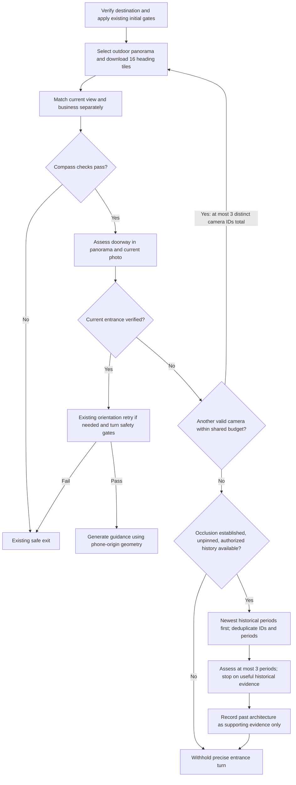

# Experimental occlusion-aware entrance assessment

Status: implemented behind a server-side opt-in, disabled by default. No historical imagery provider is configured. This is not evidence of field accuracy or a production rollout.

## Previous and updated behavior

The existing Last Meters flow verifies the destination, selects outdoor Street View cameras, downloads 16 heading tiles per camera, matches the user's photo, and matches the business. Its storefront/sign match and nearby reference/sign backups can supply destination evidence without independently classifying the doorway in the live photo.

With the experiment enabled, existing current-view matching and destination matching remain separate. A further structured assessment distinguishes business identity from doorway visibility in both the selected panorama and the user's photo. A business sign alone cannot satisfy this check. The legacy independent reference-camera/sign backups are replaced in this path by the existing shared, maximum-three-camera search. The default path is unchanged.

A camera showing the door can supply entrance evidence, but cannot replace the user's compass heading. The existing confidence, walking-route, GPS, heading, movement and late sensor checks still run before precise guidance. Place ID resolution, Places ranking and safety thresholds are unchanged.

The diagram shows the experimental path. When the switch is off, legacy behavior and Trial snapshots remain unchanged. Existing compass conflicts can exit before any doorway assessment. The existing current-view retry can continue after a doorway match if the user's view was not corroborated; a later contradiction in the live photo prevents restoring an earlier doorway match.

## Four classifications

| State | Meaning |
| --- | --- |
| `VISIBLE` | An identifiable entrance door is visible in the specific image source. This label by itself does not authorize a turn. |
| `OCCLUDED` | An obstruction prevents sufficient inspection of the likely entrance area. It does not prove a door exists behind it. |
| `NOT_VISIBLE` | No matching destination entrance was found in that source. |
| `UNCERTAIN` | Evidence is insufficient or contradictory, or the model response is invalid. |

The assessment also records storefront identity, obstruction category, matching doorway geometry, appearance changes and the panorama heading. Verification requires the existing map-consistent business match, a door visible in both sources, matching doorway geometry, and a map-consistent door heading. A blocked current photo or changed entrance prevents a later contradictory assessment from upgrading the same photo to verified.

## Configuration and historical provider

Enable only on a controlled test backend with `LAST_METERS_OCCLUSION_AWARE=true`; restart that backend after changing its environment. Omit the variable or use any value other than `true` to keep the default path. No secret or environment file is added by this change. Expo updates alone do not enable backend behavior.

Internal callers can pass `LastMetersRunOptions.occlusion`. This option is not read from the mobile request body. A documented, authorized future provider may implement `HistoricalPanoramaProvider.list` and `loadView` and be supplied through that internal option. Its diagnostic ID must contain no secrets. There is **no production implementation and no historical API key to configure in this change**. Tests use only a mocked provider, `authorized-test-fixture` or `test-only-authorized-history`.

Google Street View Static API does not document a general history-enumeration or arbitrary capture-date parameter. Capture dates in metadata describe the selected image; they are not a history search. See [Street View requests](https://developers.google.com/maps/documentation/streetview/request-streetview) and [metadata](https://developers.google.com/maps/documentation/streetview/metadata). No private endpoint, UI scraping, invented date parameter or implicit historical reinterpretation of nearby cameras is used.

Historical retrieval requires an established storefront with observed occlusion, an unpinned request, a known selected capture period, remaining budget and a configured authorized provider. Returned metadata must match the Verified destination's Place ID, have a valid nearby camera within 75 meters of the target, and identify a capture period strictly older than every known assessed selected period. Unknown dates, future periods, IDs already evaluated in the nearby search, and overlapping periods are excluded. Year-only dates overlap every month in that year. Up to three periods are examined, newest first. One target-facing view, using its own camera geometry, is assessed per period. A useful historical door stops further historical requests but **never sets current entrance verification**.

## Bounds and Trial evidence

- The existing nearby search budget remains three distinct evaluated panorama IDs and a 45-second deadline starting at the initial search. Sixteen views are still sixteen headings of one camera, not sixteen locations.
- Experimental B/C matching, entrance assessments and provider operations share that deadline; each such operation is capped at eight seconds and does not retry internally. Tile requests use the remaining search deadline, capped at their existing 20-second timeout. A slow initial search can leave no time for history. This deadline does not include later route lookup, guidance generation or Trial persistence.
- Successful current entrance matching does not request history. Original-panorama retries remain pinned and do not invoke history.
- A new `entrance_assessment` step is saved in the existing Trial `steps` array. No existing database field or API name is renamed. The response is structured JSON containing original ID/date, examined cameras, per-source classifications, storefront evidence, historical attempts and observations, provider/status, entrance verification, failure reason and additional request count. Existing panorama audit entries retain rejected camera attempts.
- `additionalApiRequests` counts requests after the initial camera acquisition, excluding the first normal B/C pair: extra entrance assessments, alternative camera metadata/previews/classification/16 tiles/B/C, and historical list/image/assessment calls. It includes failures that started; it is not a monetary cost estimate. A provider contract forbids hidden internal retries/pagination. The step's `durationMs` measures elapsed matching/fallback time after the first panorama has downloaded. Entrance and historical assessment timing also accumulates under the existing `destinationMatch` module.
- Historical images stay transient; only structured evidence enters this step. Provider exception messages, signed URLs and keys are not recorded. Coordinates, where present in observations, stay in the protected Trial record; no new location console logging is added. Existing dashboard grouping is unchanged; consumers can inspect the raw step JSON.

## Validation

Files changed:

| File | Purpose |
| --- | --- |
| `mobile/server/services/lastMetersEntranceAssessment.ts` (new) | Structured door assessment, bounded provider interface, historical selection and Trial evidence. |
| `mobile/server/services/lastMetersPanoramaMatching.ts` | Integrate assessments and fallback into the existing camera loop; preserve compass and pinned exits. |
| `mobile/server/services/lastMetersService.ts` | Internal configuration and default-off environment switch. |
| `mobile/server/services/lastMetersTurnDecision.ts` | Reject explicitly unverified experimental entrance evidence. |
| `mobile/server/services/outdoorPanoramaSelection.ts` | Shared request accounting. |
| `mobile/server/services/streetViewPanorama.ts` | Account for tiles and apply remaining experimental search budget to their timeouts. |
| `mobile/src/test/lastMetersEntranceAssessment.test.ts` (new) | State parsing, historical selection, cancellation, privacy and changed-door tests. |
| `mobile/src/test/lastMetersPanoramaMatching.test.ts` | Camera fallback, original heading, pinned retry, request accounting and withheld historical response tests. |
| `mobile/src/test/lastMetersTurnDecision.test.ts` | Unverified-door rejection and retained sensor gates. |
| `mobile/src/test/lastMetersExits.test.ts` | Full mobile and strict request-path tests with the experiment enabled. |
| `mobile/src/test/runAll.test.ts` | Register the new assessment tests. |
| `docs/occlusion-aware-panorama.md` (new) | Architecture, configuration, provider constraints, validation and limitations. |

The original baseline passed 494 tests. The updated suite passed 530 tests, including 36 additional cases. All provider and vision calls in the new tests are mocked; no paid API requests are made.

| Required scenario | Coverage |
| --- | --- |
| First camera has a visible entrance | No fallback or historical requests; full mobile and strict paths reach guidance only after existing gates. |
| Sign/storefront visible but doorway obstructed | Separate classification; no sign-only entrance confirmation. |
| Second camera reveals the door | Correct camera bearing retained; user heading remains the phone heading. |
| All available cameras obstructed | Three-camera cap, request accounting, safe withheld response. |
| Three historical capture periods | Newest-first ordering and a three-period cap. |
| No historical images/provider | Distinct unavailable and no-usable-history outcomes. |
| Only an old entrance is visible | Early historical stop; API response still has `targetHeading: null` and `guidanceKind: withheld`. |
| Storefront moved/door changed | No promotion or restoration after contradictory current evidence. |
| Duplicate history IDs/periods | IDs and overlapping year/month periods are deduplicated. |
| Historical timeout/failure | Abort, sanitized failure, no late-state mutation, attempted ID/date retained on image failure. |
| Unsupported precise turn | Matching and turn-decision tests reject it, including under a permissive test policy. |
| Existing non-occluded behavior | All original characterization snapshots and tests continue to pass unchanged with the feature off. |

Commands from `mobile/`: `npm run qa` (native type check and test suite); `npm run typecheck:server`. Both pass. No existing snapshot was regenerated.

## Remaining limits

This does not provide access to historical Google imagery. A permitted provider must be integrated and reviewed separately. Requiring a visible live doorway is deliberately conservative; a sign-only or heavily occluded user photo may still be withheld despite useful old imagery. Vision output is probabilistic, and repeated model calls are not independent ground truth. Building change detection, repeated storefronts, viewpoint offsets and occlusion classification need labeled field evaluation before rollout. A visible entrance does not establish opening hours, accessibility or a safe walking path. The feature remains disabled by default and has not been deployed.
